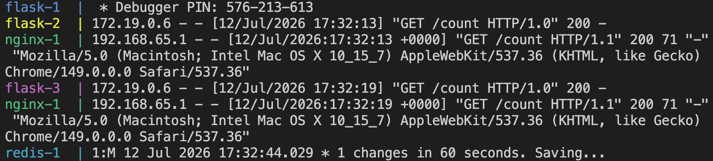
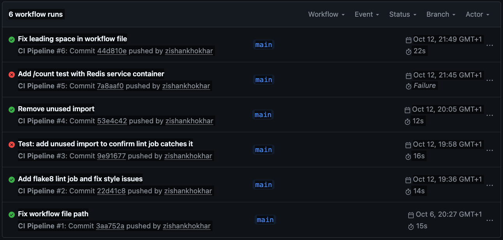

# Flask + Redis: Containerized Multi-Service App


A multi-container app built with Docker Compose — Flask + Redis + nginx,
with persistent storage, service discovery, and horizontal scaling with
load balancing.

**[Docker Hub — flask-redis-app](https://hub.docker.com/r/zishankhokhar/flask-redis-app)** · **[Docker Hub — flask-redis-redis](https://hub.docker.com/r/zishankhokhar/flask-redis-redis)**

---

## Architecture

client → nginx (load balancer) → flask ×N replicas → redis (persistent volume)

| Service | Role |
|---|---|
| `flask` | Stateless web service, scales horizontally |
| `redis` | Key-value store, custom Dockerfile, AOF + RDB persistence |
| `nginx` | Reverse proxy, sole point of ingress |

## Screenshots

<p align="center">
  
  <br/><em>Visit counter served by a Flask replica, backed by Redis</em>
</p>

<br/>

<p align="center">
  
  <br/><em>docker compose up — nginx load-balancing across 3 Flask replicas</em>
</p>

## Quick start

```bash
docker compose up --build
docker compose up --build --scale flask=3   # scale the web tier
```

→ `http://localhost:5002/` · `http://localhost:5002/count`

## Key design decisions

| Problem | Solution |
|---|---|
| Containers can't reach each other via `127.0.0.1` | Service-name DNS via Docker Compose (`REDIS_HOST=redis`) + env vars, no hardcoded IPs |
| Redis data was lost on `docker compose down` | Named volume (`redis_data:/data`) decouples state from container lifecycle |
| Scaling flask broke — replicas can't share a host port | nginx reverse proxy as single ingress point, load-balances across replicas |

## Verify persistence

```bash
docker compose down       # containers removed, volume kept
docker compose up -d
curl http://localhost:5002/count   # continues, doesn't reset
```

## What I'd add next

- Managed/HA Redis (single instance is a state bottleneck)
- Health checks (`depends_on` only controls start order, not readiness)
- CD: build and push the Docker images to Docker Hub automatically from the pipeline (CI for lint and tests is already in place, see below)

---

## CI Pipeline


Every push and pull request runs an automated pipeline in GitHub Actions. It checks code style and verifies the application's behaviour against a real Redis instance, so broken code is caught before it reaches `main`.



### How it works

| Job | Purpose | What it runs |
|---|---|---|
| `lint` | Is the code written cleanly? | `flake8` against the `app/` directory |
| `test` | Does the application work? | `pytest` against a live Redis service container |

The two jobs run in parallel on separate runners. A red `lint` job points to a style problem. A red `test` job points to broken behaviour. The failing job's name tells you which kind of problem it is before you open a log.

**Triggers:** `push` and `pull_request`. Running on pull requests means a failing change is visible on the PR before it merges.

### Design decisions

- **Separate jobs for lint and test.** They fail independently, run concurrently, and each can be re-run on its own.
- **Redis as a service container.** The `/count` route depends on Redis, so the `test` job starts a `redis:7` container next to the tests instead of mocking the connection. The service is exposed on `localhost:6379`, the app's default address, so no application code changes were needed for CI.
- **Health check on the service.** The container is configured with `redis-cli ping` checks, so test steps only start once Redis is accepting connections. Without it, tests can fail intermittently if they start before Redis is ready.
- **Behavioural test for the counter.** The count depends on how many visits have happened before, so the test asserts the *increment* (two requests, difference of exactly one), not an absolute value.
- **Lint rules in version control.** A root `.flake8` file raises the line-length limit to 100 and excludes the virtual environment, so local runs and CI use identical rules.
- **Dev tooling kept out of `requirements.txt`.** `flake8` is installed only in the `lint` job, because the application doesn't need it to run.

### Running the checks locally

```bash
# Lint
flake8 app

# Tests (the /count test needs Redis on localhost:6379)
docker run -d --name test-redis -p 6379:6379 redis:7
pytest app/
docker rm -f test-redis
```

### Troubleshooting log

| Symptom | Root cause | Fix |
|---|---|---|
| Actions tab showed the "get started" page; no workflow ran | Workflow file was nested at `.github/workflows/.github/workflows/ci.yml`, and GitHub only scans one level | Moved it to `.github/workflows/ci.yml`; verified with `find .github -type f` |
| `pip: command not found` after renaming the project folder | A virtual environment records its absolute path at creation, so the rename broke it | Deleted and recreated the venv, then reinstalled from `requirements.txt` |
| `/count` test returned 500 locally | No Redis listening on port 6379 | Started a throwaway Redis container; the same fix applies in CI via a service container |
| "Invalid workflow file: Required property is missing: jobs" | A single leading space on line 1 of `ci.yml`, invisible in the editor | Found with `cat -vet`, removed the space |
| `lint` job failed with exit code 1 | Deliberate unused import, added to confirm the linter actually blocks bad code | Removed the import; pipeline returned to green (see run history) |

### Known considerations and next steps

- Runners use `ubuntu-latest`, which GitHub is migrating to Ubuntu 26 on 19 October 2026. Pinning to a fixed image would make runner upgrades a deliberate change.
- Tests currently run on a single Python version. A matrix build would cover several.
- Next: build and push the Docker image from the pipeline (the CD half).

